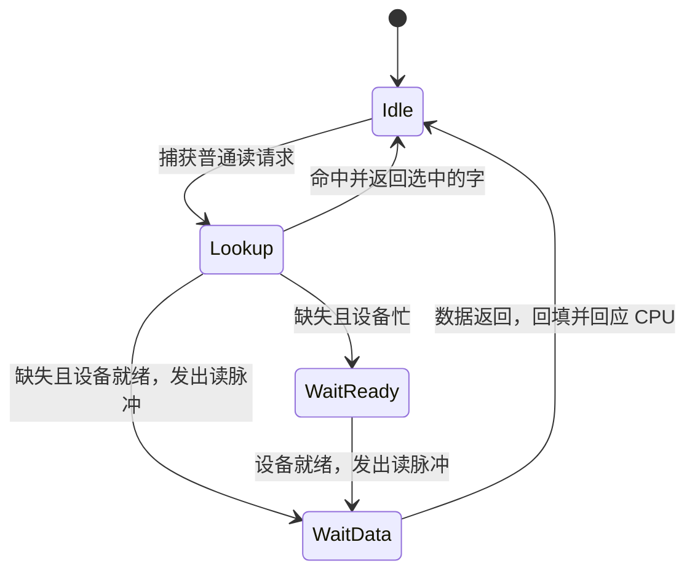

# 缓存结构和接口

[ICache](../rtl/ICache.v) 和 [DCache](../rtl/DCache.v) 分别装有 64 行，每行存放 16 字节数据，各自的数据容量为 1 KiB。普通存储区采用 32 KiB 地址范围 `0x00000000` 到 `0x00007fff`，DCache 还识别 `0xffff0000` 到 `0xffffffff` 的外设窗口。

| 地址位 | 用途 |
| --- | --- |
| `[14:10]` | 5 位 tag，用于判断这一行是否属于当前主存块 |
| `[9:4]` | 6 位索引，选出 64 行中的一行 |
| `[3:2]` | 4 个 32 位字中的一个 |
| `[1:0]` | 字节位置，由 CPU 的访存掩码或取指对齐约定处理 |

行的布局为 `{valid, tag, data}`。同步 [行 RAM](../rtl/cache_line_ram.v) 在时钟沿采样索引，写入时输出新行。高电平复位清除有效位，使第一次访问经历冷缺失。数据块按小端布局，最低地址的字在返回块的 `[31:0]`。

## 读与回填

ICache 使用一拍的 `inst_rreq` 捕获取指地址，通过 `inst_valid` 返回 `inst_out`。DCache 使用非零 `data_ren` 捕获读请求，通过 `data_valid` 返回选中的 32 位字。普通读缺失将地址向下对齐到 16 字节，并以 `cpu_ren = 4'hf` 请求一整行。设备维持 `dev_rrdy` 直到捕获该读脉冲，完成后用 `dev_rvalid` 和 `dev_rdata` 返回数据。

DCache 允许 CPU 在等待时持续拉高同一读请求。已响应的地址在 `data_ren` 清零或地址变化前会被屏蔽。再次读取同一地址时，先让 `data_ren` 在一个时钟沿为零。

## 写直达与外设访问

DCache 接收一拍的 `data_wen`、地址和写数据。写命中使用字节掩码合并新旧数据，再把请求送往设备。写缺失直接转发写请求，原缓存行保留。已接受的总线写由设备拉低 `dev_wrdy` 进入忙状态，完成时重新拉高，DCache 随后给出一拍 `data_wresp`。

外设读写沿用原始地址和掩码。外设读取 `dev_rdata[31:0]`，外设写直接发往设备，两者均绕过行 RAM。DCache 的读写状态机共享一个 SRAM 端口和 CPU 侧地址，调用方每次提交一笔事务，收到响应后再发下一笔。

## 波形检查

执行 `python3 tools/check.py rtl --waves` 后查看 `build/tb_icache.vcd` 和 `build/tb_dcache.vcd`。取指测试先延迟 `dev_rrdy`，再观察缺失请求、回填、同一行命中以及同索引异 tag 的替换。数据缓存测试在写就绪延迟时提交部分写入，确认缓存和主存都合并字节，并用同一索引的外设地址验证外设操作不污染已有缓存行。
